# Italian Energy Demand & Solar Forecasting

<p align="center">
  
</p>

<p align="center">
  <strong>An exploratory time-series forecasting project using hourly Italian electricity data and ARIMA.</strong>
</p>

<p align="center">
  
  
  
  
</p>

## Project overview

This project explores two hourly electricity time series for Italy during 2016:

- **Electricity load** (`IT_load_new`)
- **Solar generation** (`IT_solar_generation`)

The Jupyter notebook takes the data from initial inspection through missing-value handling, visualization, stationarity testing, ARIMA fitting, and test-period forecast comparison. The goal is to demonstrate a practical classical forecasting workflow—not to provide a production-ready energy forecasting service.

## What the notebook does

1. Loads the CSV with pandas and inspects the observations.
2. Plots the load and solar-generation series over time.
3. Checks for missing values and forward-fills missing electricity-load values.
4. Applies the **Augmented Dickey–Fuller (ADF)** test to assess stationarity.
5. Inspects autocorrelation and partial autocorrelation plots to guide ARIMA orders.
6. Reserves the final 20% of observations as a chronological test set.
7. Fits ARIMA models and compares their predictions with the held-out observations using **root mean squared error (RMSE)** and plots.

```mermaid
flowchart LR
    A[Hourly CSV] --> B[Inspect and clean]
    B --> C[Visualize time series]
    C --> D[ADF stationarity test]
    D --> E[ACF and PACF analysis]
    E --> F[Chronological 80/20 split]
    F --> G[Fit ARIMA models]
    G --> H[Forecast test period]
    H --> I[RMSE and forecast plots]
```



## Dataset

The included file, `TimeSeries_TotalSolarGen_and_Load_IT_2016.csv`, contains three columns:

| Column | Description |
| --- | --- |
| `utc_timestamp` | Timestamp in UTC, formatted as an ISO-8601 string |
| `IT_load_new` | Italian electricity-load observation |
| `IT_solar_generation` | Italian solar-generation observation |

The data is hourly and covers 2016. **The measurement units and original upstream data source are not documented in the files included in this repository.** Check the source dataset's documentation before interpreting values as a particular physical unit or using them in operational decisions.

## Findings in the notebook

- The notebook's ADF outputs report p-values of approximately **3.84 × 10⁻²²** for electricity load and **6.27 × 10⁻⁷** for solar generation. Under the test's assumptions, both results provide evidence against the unit-root null at common significance levels.
- The notebook uses an **80% training / 20% test** split that preserves time order.
- The notebook reports approximate test RMSE values of **7,715** for its load model and **2,486** for its solar model.

These are the values reported in the notebook, not independently benchmarked results. RMSE is scale-dependent, so the two series' RMSE values should not be compared directly. The notebook is exploratory: its results do not establish that the models are suitable for future periods, and the reported errors should be re-evaluated against simple baselines and a clearly specified validation strategy before drawing conclusions.

## Repository contents

```text
.
├── assets/
│   └── arima-forecast-overview.svg
├── TimeSeries_TotalSolarGen_and_Load_IT_2016.csv
└── Use Case 1 - Energy Demand Forecasting using ARIMA (1).ipynb
```

## Run the project

### Requirements

- Python 3.9 or later
- Jupyter Notebook or JupyterLab

### Setup

From the project directory, create and activate a virtual environment if desired, then install the notebook dependencies:

```bash
python -m venv .venv
```

On Windows PowerShell:

```powershell
.\.venv\Scripts\Activate.ps1
```

On macOS or Linux:

```bash
source .venv/bin/activate
```

Install the packages used by the notebook and start Jupyter:

```bash
python -m pip install pandas numpy matplotlib statsmodels scikit-learn jupyter
jupyter notebook
```

Open **`Use Case 1 - Energy Demand Forecasting using ARIMA (1).ipynb`** in the Jupyter interface and run the cells from top to bottom. Keep the CSV in the project directory: the notebook reads it using a relative filename.

## Model notes and limitations

- **ARIMA(p, d, q)** combines autoregressive terms (`p`), differencing (`d`), and moving-average terms (`q`). The notebook tries orders including `(2, 0, 2)` and, for load, differenced alternatives.
- The test set is the final portion of the year, rather than a random sample, so the evaluation respects temporal ordering.
- ADF results depend on test assumptions and do not guarantee that a series is well modeled by a non-seasonal ARIMA process.
- The data is hourly, but the notebook does not implement an explicitly seasonal model. Daily and weekly patterns may therefore be missed.
- The project does not document units, source provenance, uncertainty intervals, or a deployed forecasting interface.
- The notebook should be reviewed and re-run before treating its saved outputs or reported metrics as current results.

## Ideas for further work

- Compare ARIMA against persistence and seasonal-naive baselines.
- Use rolling-origin or walk-forward validation across multiple forecast windows.
- Evaluate seasonal methods (such as SARIMA) to represent hourly and weekly cycles.
- Report MAE alongside RMSE and inspect residual autocorrelation.
- Document the dataset source, units, and any preprocessing decisions.

## License and data attribution

No license or source attribution is included with the project files. Confirm the dataset's terms and add appropriate attribution before redistributing the data or using it beyond its permitted scope.
